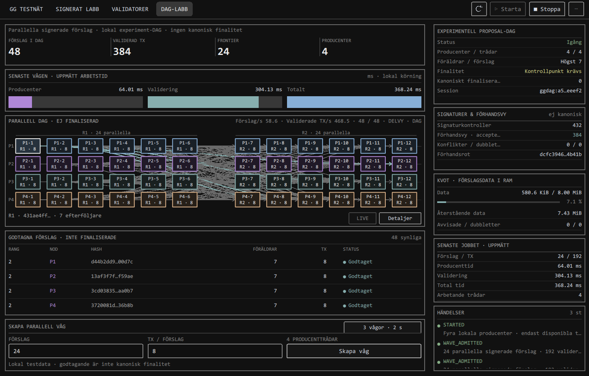
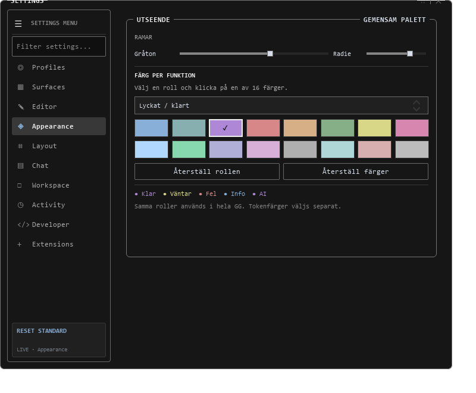

# GG nätverk och färgval: faktisk v13-QML

Detta är bilder från egna, avgränsade verifieringsfönster. De är **faktiskt
renderad QML**, inte nya genererade koncept eller skärmbilder av användarens
öppna program. Inga återställningsord, privata nycklar, logins eller riktiga
walletkonton ingår. Ursprungliga konceptet finns i den tidigare v12-mappen.

## Parallell DAG

Källa: `tests/test_parallel_dag_dashboard_ui.py`, native Direct3D11-fixtur,
970 × 620 logiska pixlar. Originalfil:
`.runtime/network-v13-final/dag/direct3d/dag-970.png`.

Det egna provet skapar disponibla signeringsidentiteter i RAM och låter riktiga
QML-kontroller köra två omgångar med signerade testförslag. Bilden visar 48
förslag, 384 validerade testposter och verkliga flerföräldralänkar. Tider och
noteringar hör till detta lokala test. Inga publika peers, verkliga tillgångar
eller kanoniskt slutliga transaktioner påstås. Vyn anger att kontrollpunkt
krävs och att antalet kanoniskt finaliserade poster är noll.

## Sexton färger per funktion

Källa: `tests/test_runtime_theme.py`, egen settings-/controllerfixtur med
tillfällig inställningsfil och offentliga syntetiska statusetiketter.
Originalfil: `.runtime/theme-v13/appearance-semantic-16.png`.

I just denna bild har testet valt **lila för rollen Lyckat/klart** för att visa
att enskilda roller faktiskt kan ändras och att andra vyer målas om direkt.
Standard för rollen är grön. Fel är rött, väntar gult, information blått och
AI lila innan användaren väljer egna roller. Provets fortsättning verifierar
tangentbordsval, sparning, ny läsning och återställning utan att ändra ramgråton
eller radie. Ingen användarinställning ändrades.

Walletens syntetiska layoutprov använder även ett avsiktligt oprissatt,
påhittat kontrakt för att kontrollera hur okänd värdering visas. Den bilden
publiceras inte här som om den vore den riktiga GGHB-minten. Dess riktiga
indikativa prisväg och kontroll finns i
[prisunderlaget](../../token-market-pricing.md).
