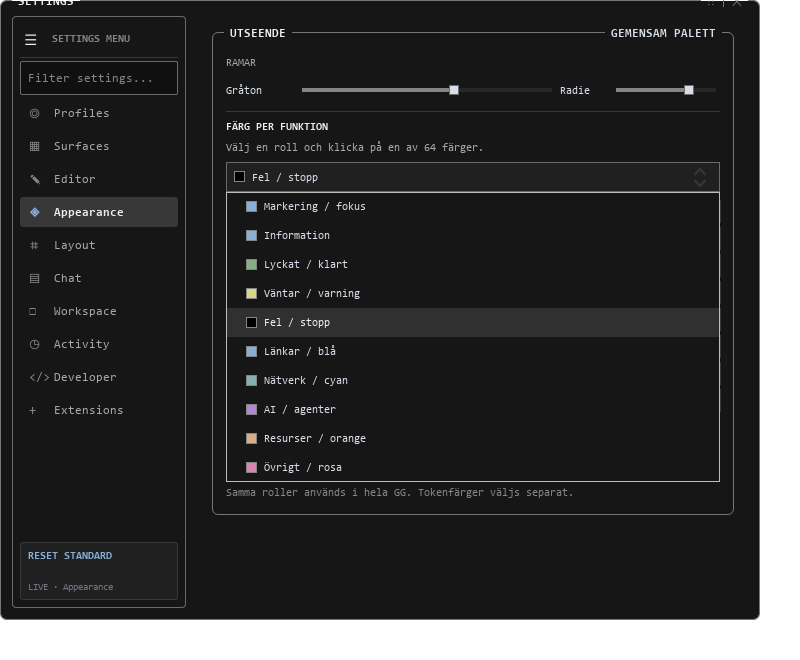
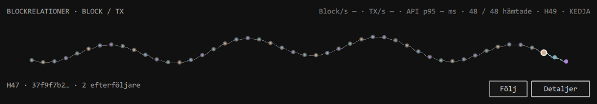
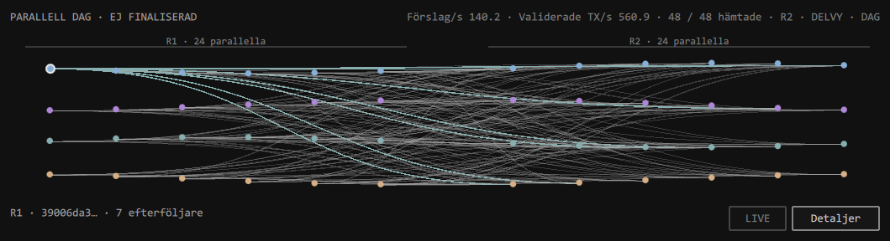

# GG: verifierade färg- och punktvyer

Bilderna kommer från egna, tillfälliga QML-testfönster. De visar faktiskt
renderad UI-kod. De är inte användarens öppna program, riktiga walletkonton
eller ett påstående om en ny konsensus. Inga privata nycklar eller ord ingår.

Källa: `tests/test_runtime_theme.py`, 64-valspalett och verklig rollväljare.
Provinställningar sparas i en tillfällig fil och påverkar inte användarens färger.

Källa: `tests/test_block_relations_graph.py`, offentlig syntetisk kedjefixtur
med kända hash-/föräldrarelationer. Native-renderingen kontrolleras i reducerad
rörelse eftersom testfönstret ligger utanför skärmen; den bilden mäter inte FPS.
Software-provet verifierar även animering och att tomgången slutar rita.

Källa: `tests/test_dag_relations_graph.py`, faktiskt lokalt skapade och
kontrollerade signerade testförslag. 48 punkter och 168 verkliga föräldralänkar
visas. Det är ett avgränsat test på en dator, utan P2P eller kanonisk slutlighet.
Genomströmningstalen i bilden är lokala observationer från just provet.

Punkternas placering är diagramlayout. Höjden på kurvan är inte en uppmätt
latens eller ett säkerhetsvärde. Data är blocken, deras metadata och de
kontrollerade föräldralänkarna. Inga extra länkar skapas för dekoration.

[Användning, avgränsning och verifiering](../../gg-ui-colors64.md).
