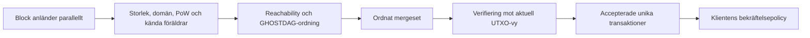

# DAGoblin: Kaspa, GHOSTDAG och DAGKnight

Researchläge 2026-10-29. Den här delen granskar originalforskning och utvalda funktioner i officiell källkod. Den ändrar inget konsensusprotokoll och intygar ingen ny finansiell säkerhet. Maskinläsbar källförteckning finns i [kaspa-primary-sources.json](kaspa-primary-sources.json).

## Ursprunglig avsikt

GG ska kunna ta emot verkligt parallella block med flera föräldrar och korsande länkar, utan att kräva att varje telefon behandlar hela världens arbete. Användarens mål är bättre hastighet, säkerhet, resurskostnad och användbarhet än dagens alternativ. Namnet på den föreslagna forskningslinjen är DAGoblin. Målet är inte uppnått genom att byta namn på GHOSTDAG eller rita en snabbare graf.

**Beslut för denna undersökning:** skilj publicerad teori, driftsatt kod, utvecklingsgren, egen slutsats och ännu oprövad hypotes. GG:s befintliga parallella förslags-DAG är fortfarande ett lokalt experiment med fyra fasta testproducenter, obekräftad antagning och noll kanoniskt finaliserade transaktioner. Ett granskat checkpoint-/konsensussteg saknas fortfarande där.

## Verifierad utgångspunkt

| Underlag | Verifierad status vid granskningen | Vad det inte bevisar |
| --- | --- | --- |
| Kaspa mainnet | Officiella webbplatsen anger 10 block/s. | Inte mätt TPS, exakt intervall mellan varje block eller en garanti om finalitet efter 100 ms. |
| Rusty Kaspa | Senaste officiella release var v2.1.0, publicerad 2026-09-22. Källanalysen nedan är låst till `01b532e8b553523216471682649693af92f0fd16`. | En release/tagg bevisar inte vilka versioner samtliga publika noder faktiskt kör. |
| PHANTOM/GHOSTDAG | Originalets 14 sidor hämtades från Kaspa-forskningens officiella repo; daterat 2021-11-10. | Fullständig oberoende formalisering eller reproduktion av alla sannolikhetsbevis. |
| Prunality | Originalets fem sidor, juli 2020, hämtades från samma repo. | Att 2020 års formel oförändrad beskriver alla senare pruningregler. |
| DAGKnight | Originalets metadata/abstract verifierade; KIP-0002 står som Proposed. Officiell separat utvecklingsgren finns. | Driftsatt DAGKnight på mainnet eller verifierad prestanda för den grenen. |

Källor: [Kaspa LORE](https://kaspa.org/lore), [release v2.1.0](https://github.com/kaspanet/rusty-kaspa/releases/tag/v2.1.0), [GHOSTDAG-original](https://raw.githubusercontent.com/kaspanet/research/c923faca11a49148fa7d912d27ce00197a5c5a4a/ghostdag/Ghostdag.pdf), [Prunality-original](https://raw.githubusercontent.com/kaspanet/research/c923faca11a49148fa7d912d27ce00197a5c5a4a/prunality/Prunality.pdf), [KIP-0002 vid granskad revision](https://github.com/kaspanet/kips/blob/e4ae2332117b5cb68bd6188e065ef885b6d17939/kip-0002.md).

Utvecklingsgrenen DAGKnight analyseras separat vid `ad45e241e6688a14901fd24dd8dc33c5c9a33f40`, daterad 2026-09-08. Dess mainnetkonfiguration har `dagknight_activation: never()`. `TESTNET13_PARAMS` aktiverar funktionen från genesis men saknar DNS-seeders. Det är verifierad konfiguration, inte ett belägg för ett offentligt tillgängligt eller stabilt testnät. [Grenens nätverksparametrar](https://github.com/kaspanet/rusty-kaspa/blob/ad45e241e6688a14901fd24dd8dc33c5c9a33f40/consensus/core/src/config/params.rs#L592).

Officiella webbplatsen beskriver DAGKnight efter Toccata och anger 25–40 ms som mål samt 100 BPS som riktning för 2027. Detta är publicerade mål, inte våra uppmätta resultat. Sidans formuleringar om nätverksdelning och säkerhet är protokollanspråk som fortfarande måste knytas till rätt modell, bevis och implementation. [Aktuell färdplan](https://kaspa.org/lore).

## Vad originalforskningen faktiskt ger

PHANTOM söker ett maximalt k-kluster, ett beräkningssvårt problem. GHOSTDAG använder en girig variant. `k` begränsar blå anticone: block som saknar inbördes förfädersrelation. Det är inte antal föräldrar, quorum eller bekräftelsedjup. Den publicerade GHOSTDAG-satsen kräver rätt parameterisering, Poissonbaserad blockproduktion och en tillräcklig gräns för ärlig meddelandefördröjning. Angriparen får godtyckligt undanhålla block och sakna egen kommunikationsfördröjning. Säkerhetströskeln anges som minst `(1−δ)/2` under modellen. Slutsatsen är asymptotisk probabilistisk ordningskonvergens, inte omedelbar finalitet. Författarna skiljer detta från snäva praktiska bekräftelsetider, vars konstanter behöver bättre analys. Artikelns historiska mätning av 40 TPS är inte ett aktuellt kapacitetstal. [Originalet, §2–5 och appendix A](https://raw.githubusercontent.com/kaspanet/research/c923faca11a49148fa7d912d27ce00197a5c5a4a/ghostdag/Ghostdag.pdf).

DAGKnight tar bort en förutbestämd latensgräns ur själva ordningsprotokollet. Originalets abstract kräver fortfarande att klienten lokalt anger en gräns för aktuell maximal adversariell fördröjning; nod- och nätkapacitet gäller fortfarande. Parametrlös betyder alltså inte antagandefri eller säker bekräftelse vid observerad minimilatens. Tolerans nära hälften av beräkningskraften hör till denna PoW-modell, inte till antal anslutna datorer. **Bevislucka i denna granskning:** original-PDF:en nekade hämtning med HTTP 403. Abstract och metadata lästes, men hela DAGKnight-beviset har inte granskats från ett autentiserat original. [IACR originalpost](https://eprint.iacr.org/2022/1494), [författarens institutionspost](https://appliedcryptographysociety.hsites.harvard.edu/publications/he-dag-knight-protocol-parameterless-generalization).

## Kartan från graf till gemensamt tillstånd

Detta är en förenklad läskarta, inte en specifikation av alla interna köer. I den granskade koden kör `HeaderProcessor::validate_header` isolerade kontroller och föräldrarelationer, bygger kontext, beräknar GHOSTDAG och kontrollerar därefter bland annat svårighetsgrad, DAA, blå poäng/arbete, tid, mergeset och indirekta föräldrar. Ett grafblock är alltså inte samma sak som en slutligt accepterad betalning. [Headerprocessorn](https://github.com/kaspanet/rusty-kaspa/blob/01b532e8b553523216471682649693af92f0fd16/consensus/src/pipeline/header_processor/processor.rs#L246).

### Föräldrar, k och mergeset är olika budgetar

| Storhet vid granskad 10-BPS-konfiguration | Värde | Innebörd |
| --- | ---: | --- |
| Målfrekvens | 10 BPS | Genomsnittligt produktionsmål. |
| Måltid | 100 ms | Parameter härledd ur BPS, inte bekräftelsetid. |
| GHOSTDAG k | 124 | Förvald tolerans för blå anticone. |
| Maximala direkta föräldrar | 16 | Gräns för antalet direkta referenser. |
| Maximalt mergeset | 248 | Tak för den nya historik som kan fogas in. |
| Kandidater vid virtuals föräldraval | 48 | Tre gånger direkta föräldrataket. |
| Merge-depth | 36 000 blå blockenheter | Separat 1-timmesbaserad parameter vid 10 BPS. |
| Finality-depth | 432 000 blå blockenheter | Separat 12-timmesbaserad parameter; inte normal betalningsbekräftelse. |
| Pruning-depth | 1 080 000 blå blockenheter | Vald 30-timmesbaserad gräns i denna konfiguration. |

Härledda värden har räknats direkt från [BPS-generatorn](https://github.com/kaspanet/rusty-kaspa/blob/01b532e8b553523216471682649693af92f0fd16/consensus/core/src/config/bps.rs#L25), [tidskonstanterna](https://github.com/kaspanet/rusty-kaspa/blob/01b532e8b553523216471682649693af92f0fd16/consensus/core/src/config/constants.rs#L65) och [virtuals kandidattak](https://github.com/kaspanet/rusty-kaspa/blob/01b532e8b553523216471682649693af92f0fd16/consensus/src/pipeline/virtual_processor/processor.rs#L975). De tre djupen är baserade på blå poäng, inte en garanti om motsvarande väggklocktid under alla nätförhållanden.

Pruningformelns lägre gräns blir `432000 + 2×36000 + 4×248×124 + 2×124 + 2 = 627258`; koden väljer det större av denna och 1 080 000. Det är egen aritmetisk härledning, inte en nätverksmätning. Den separata funktionen `calculate_ghostdag_k` beräknar en Poissonsvans. Vi får inte automatiskt likställa just hjälpfunktionen med alla termer i originalartikelns säkerhetsparameterisering.

### Verkligt föräldraval och färgning

`pick_virtual_parents` börjar med en UTXO-giltig vald förälder. Övriga antichain-kandidater rangordnas efter blått arbete; en del prioriteras och en del randomiseras för att sprida referenser. Kandidater och resultat klipps av mot föräldra- och mergesetbudgetar. Föräldrar som bryter merge-depth tas bort och GHOSTDAG räknas om. Detta är betydligt mer än att godtyckligt länka till de senaste sju noderna. [Val och begränsad omräkning](https://github.com/kaspanet/rusty-kaspa/blob/01b532e8b553523216471682649693af92f0fd16/consensus/src/pipeline/virtual_processor/processor.rs#L1053).

GHOSTDAG väljer den förälder som maximerar `(blue_work, hash)`. I ett ordnat mergeset får en kandidat bli blå bara om både kandidatens och de berörda befintliga blå blockens anticone håller gränsen. Den andra kontrollen får inte tas bort som en prestandaoptimering. Blå poäng och blått arbete räknas om från accepterad information, inte från en obetrodd avsändares påstående. [GHOSTDAG-kroppen](https://github.com/kaspanet/rusty-kaspa/blob/01b532e8b553523216471682649693af92f0fd16/consensus/src/processes/ghostdag/protocol.rs#L99), [ordningen](https://github.com/kaspanet/rusty-kaspa/blob/01b532e8b553523216471682649693af92f0fd16/consensus/src/processes/ghostdag/ordering.rs#L1), [kontroll av deklarerade värden](https://github.com/kaspanet/rusty-kaspa/blob/01b532e8b553523216471682649693af92f0fd16/consensus/src/pipeline/header_processor/post_pow_validation.rs#L9).

Direkta föräldrar måste utgöra en antichain: att lägga till både en förälder och dess redan täckta förfader är inte fri extra säkerhet. Headerns flernivåföräldrar är dessutom komprimerad historik för olika nivåer. De ska inte räknas som lika många nya oberoende tips. [Föräldrakontroller](https://github.com/kaspanet/rusty-kaspa/blob/01b532e8b553523216471682649693af92f0fd16/consensus/src/pipeline/header_processor/pre_ghostdag_validation.rs#L1), [flernivåbyggaren](https://github.com/kaspanet/rusty-kaspa/blob/01b532e8b553523216471682649693af92f0fd16/consensus/src/processes/parents_builder.rs#L1).

### Dubbelspendering försvinner inte genom parallellitet

`calculate_utxo_state` går igenom ett konsensusordnat mergeset och komponerar den tidigare UTXO-vyn med ändringarna från redan behandlade block. Saknade/spenderade inputs avvisas. Samtidigt använder Kaspa redan trådpoolsbaserad parallell verifiering av oberoende transaktioner inom ett block. Påståendet att Kaspa måste göra en transaktion i taget eller en transaktion per block är därför fel. [UTXO-beräkning och parallell verifiering](https://github.com/kaspanet/rusty-kaspa/blob/01b532e8b553523216471682649693af92f0fd16/consensus/src/pipeline/virtual_processor/utxo_validation.rs#L109).

Egen slutsats för DAGoblin: två signerade syskonblock kan båda vara korrekt formade men spendera samma saldo/UTXO. Lokalt förarbete kan då vara korrekt mot samma äldre rot. Antagning, konfliktlösning, kanonisk exekvering och finalitet behöver olika statusar. Medlemskapsbevis räcker inte för att acceptera båda betalningarna.

## Var resurskostnaden faktiskt ligger

| Kodområde | Vad som faktiskt utförs | Vad DAGoblin behöver mäta |
| --- | --- | --- |
| `ghostdag/mergeset.rs` | Köbaserad traversering från alternativa föräldrar, stopp vid redan täckt förflutet, sortering med cachat blått arbete. | Besökta block, sorteringskostnad och cachemissar per accepterat block. |
| `ghostdag/protocol.rs` | Anticonekontroller och vandring längs vald kedja. | Tid som funktion av k, konflikter, mergeset och angripartopologi. |
| `reachability/inquirer.rs` | Intervall för kedjeförfäder och binärsökning i future-covering-set för DAG-förfäder. Kommenterad frågekomplexitet `O(log |FCS|)`. | Databasuppslag, FCS-storlek och separata insättnings-/omindexeringskostnader. |
| `virtual_processor` | Val, begränsad merging, UTXO-diff, verifiering och lagring. | Seriell konfliktandel, parallell skalning och tid till verkligt accepterad unik TX. |
| Pruning/import | Tillfälliga lager, PoW/nivåkontroller och jämförelse av pruningbevis. | Högsta RAM, disk-I/O, avbruten import och uppstarts-/återhämtningskostnad. |

Källor: [mergeset](https://github.com/kaspanet/rusty-kaspa/blob/01b532e8b553523216471682649693af92f0fd16/consensus/src/processes/ghostdag/mergeset.rs#L1), [reachability](https://github.com/kaspanet/rusty-kaspa/blob/01b532e8b553523216471682649693af92f0fd16/consensus/src/processes/reachability/inquirer.rs#L170), [pruningbevis](https://github.com/kaspanet/rusty-kaspa/blob/01b532e8b553523216471682649693af92f0fd16/consensus/src/processes/pruning_proof/validate.rs#L104).

Kaspa begränsar direkta föräldrar till 16 uttryckligen för processkostnad och för att referenser per nätverksrunda annars kan växa kvadratiskt med BPS. Samma konfigurationsfil beskriver lagringskostnad som `O(antal headers × mergesetgräns)`. Att öka BPS, föräldrar och blockinnehåll samtidigt är därför tre kostnadsökningar, inte en gratis skalningsknapp. [Motivering i koden](https://github.com/kaspanet/rusty-kaspa/blob/01b532e8b553523216471682649693af92f0fd16/consensus/core/src/config/bps.rs#L62).

En billig förfädersfråga bevisar inte billig total grafuppdatering. Inte heller bevisar ett kort medelvärde att värsta fallet är begränsat. Den här granskningen innehåller ingen ny benchmark av Kaspa-binären; statiska kostnadsobservationer är inte uppmätta CPU-tal.

## Pruning, finality och lättklienter

Prunality-originalet skiljer finalitydjup, mergegräns och pruningdjup. Dess slutsats om att kasta gammal historik är villkorad av regler för merging/ogiltiga förfäder samt antagandet att djupa ärliga eller angriparorsakade delningar är försumbara och att ingen 51-procentsangripare finns. Det är inte ett argument för att ta bort historik efter godtyckligt fem–sju nya block. [Prunality, s.1–5](https://raw.githubusercontent.com/kaspanet/research/c923faca11a49148fa7d912d27ce00197a5c5a4a/prunality/Prunality.pdf).

Nuvarande kod kontrollerar pruningpunkter mot vald kedja/blå poäng och håller sampled pruninghistorik. Vid import byggs tillfälliga lager; proofheaders kontrolleras mot PoW och nivå. `compare_proofs_inner` jämför relevant blått arbete, kräver kvalificerande nivåer och föredrar befintligt tillstånd om utmanaren inte är strikt bättre. En header utan föräldrar får inte utges för att vara annat än genesis. [Pruning](https://github.com/kaspanet/rusty-kaspa/blob/01b532e8b553523216471682649693af92f0fd16/consensus/src/processes/pruning.rs#L105), [proofvalidering](https://github.com/kaspanet/rusty-kaspa/blob/01b532e8b553523216471682649693af92f0fd16/consensus/src/processes/pruning_proof/validate.rs#L325).

Egen designslutsats: en mobil kan vara wallet, lätt verifierare, avsändare av förberäknade transaktioner eller begränsad dataarbetare. Det är olika roller. En full verifierare som måste få alla transaktioner kan inte samtidigt slippa deras globala datatrafik genom att kallas lättnod. En lättklient måste redovisa vilken verifierad rot/checkpoint den litar på, tillgänglighetsmodell och återhämtningsväg när en leverantör försvinner.

## DAGKnight: inspekterad implementation och öppen beviskoppling

KIP-0002 kräver effektivare algoritmer än ursprunglig pseudokod, konsensushardfork och wallet-/RPC-stöd för bekräftelsepolicy. Den nämner också ett stort globalt latensskydd för exempelvis svårighetsreglering och pruning, separat från normal bekräftelsetid. Att protokollet beskrivs som parametrlöst tar alltså inte bort driftsgränser. [KIP-0002](https://github.com/kaspanet/kips/blob/e4ae2332117b5cb68bd6188e065ef885b6d17939/kip-0002.md).

Följande är **källkodsfynd i utvecklingsgrenen**, inte bevis att implementationen motsvarar hela originalbeviset:

1. `DagknightExecutor::dagknight` hittar gemensamma kedjeförfäder, grupperar konkurrerande tips enligt konfliktstruktur och använder rankning/tie-break för att välja undergrupp. Resultatet innehåller vald förälder och konfliktordnade övriga föräldrar. [Protokollkropp](https://github.com/kaspanet/rusty-kaspa/blob/ad45e241e6688a14901fd24dd8dc33c5c9a33f40/consensus/src/processes/dagknight/protocol.rs#L119).
2. `RankSearcher::search` letar först en övre k-gräns med fördubbling och därefter med binärsökning. Det begränsar antal k-utvärderingar; varje utvärderings färgning och konflikthantering har fortfarande en kostnad. [Rank-sökning](https://github.com/kaspanet/rusty-kaspa/blob/ad45e241e6688a14901fd24dd8dc33c5c9a33f40/consensus/src/processes/dagknight/rank_search.rs#L12).
3. Den aktiva kodvägen anropar `umc_cascade_voting`, använder work-viktade röster, kedjeuppdelning, appendable segmentträd och sparade checkpoints. Deficit beräknas med heltalsroten ur k. Statistik omfattar bland annat bucket flips, besökta röstblock och återanvänd checkpoint. Det är redan en betydande optimering; DAGoblin får inte påstå att dessa idéer är nya i sig. [Cascade](https://github.com/kaspanet/rusty-kaspa/blob/ad45e241e6688a14901fd24dd8dc33c5c9a33f40/consensus/src/processes/dagknight/umc_cascade.rs#L25), [faktiskt anrop](https://github.com/kaspanet/rusty-kaspa/blob/ad45e241e6688a14901fd24dd8dc33c5c9a33f40/consensus/src/processes/dagknight/protocol.rs#L364).
4. En konkret granskningspunkt finns i `compute_high_rank_witnesses`: dokumentationen beskriver union över flera k′ mellan golvet av k/2 och k, men kroppen använder endast `k.saturating_sub(1)` och har en kvarvarande omprövningsnotering. Detta är en **observerad avvikelse mellan kommentar och kropp**, inte en konstaterad sårbarhet. Ekvivalens mot specifikation/bevis behöver granskas separat. [Exakta funktionen](https://github.com/kaspanet/rusty-kaspa/blob/ad45e241e6688a14901fd24dd8dc33c5c9a33f40/consensus/src/processes/dagknight/tie_breaking.rs#L204).

Vi använder inte gamla TODO-kommentarer ensamma som funktionsstatus: protokollfilen har exempelvis en gammal UMC-notering trots ett verkligt cascade-anrop. Grenens tester har lästs selektivt men inte körts eller kompilerats här. Grenens aktuella semantik får inte blandas med release v2.1.0.

## Belastningsangrepp, Sybil och kryptografi

PoW begränsar vem som kan skapa viktiga block genom kostsamt arbete, inte genom datornamn eller antal P2P-identiteter. Fler anslutna telefoner innebär därför inte automatiskt mer ärligt säkerhetsarbete. En modell med fyra fasta godkända testproducenter har andra Sybilantaganden och kan inte jämföras direkt med en öppen PoW-marknad. [PoW i headerkontrollen](https://github.com/kaspanet/rusty-kaspa/blob/01b532e8b553523216471682649693af92f0fd16/consensus/src/pipeline/header_processor/pre_ghostdag_validation.rs#L1).

Kaspa har konkreta nätgränser: 256 MiB maximal P2P-meddelandestorlek, 1 MiB transaktionsmeddelande, 2 MiB **blockkropp**, och en gräns för ackumulerade expanderade föräldrar i komprimerade headers. Den sista är ett separat parser-/dekomprimeringsskydd, inte tillstånd att använda lika många direkta föräldrar. Releaseprosan säger förenklat maximal blockstorlek; kodens kontroll subtraherar headerdelen och gäller alltså blockkroppen. [Transportgräns](https://github.com/kaspanet/rusty-kaspa/blob/01b532e8b553523216471682649693af92f0fd16/protocol/p2p/src/core/connection_handler.rs#L47), [TX-gräns](https://github.com/kaspanet/rusty-kaspa/blob/01b532e8b553523216471682649693af92f0fd16/protocol/p2p/src/convert/tx.rs#L188), [kroppsgräns](https://github.com/kaspanet/rusty-kaspa/blob/01b532e8b553523216471682649693af92f0fd16/protocol/p2p/src/convert/block.rs#L27), [föräldrakomprimering](https://github.com/kaspanet/rusty-kaspa/blob/01b532e8b553523216471682649693af92f0fd16/consensus/core/src/header.rs#L87).

Egen slutsats: avsändarens förarbete gör inte ett överbelastningsangrepp till gratis kapacitet åt nätet. Oärliga meddelanden kostar fortfarande mottagarbandbredd, avkodning, cache, uppslag och ibland kryptografi. DAGoblin behöver per-peer- och global budget, strikt kötak, billigaste avvisning först, dubblettkontroll, bounded orphanhantering, tidsgränser och mätning av **giltig trafik under angrepp**. Tidsgränser och resurstak får inte leda till att ärliga noder beslutar olika kanoniskt tillstånd.

I den granskade signaturkoden finns secp256k1-Schnorr och ECDSA, med signaturcache och debiterade scriptkostnader. Detta är ingen postkvantumsignatur. En hashbaserad DAG eller Merkleträd gör inte dessa signaturer kvantsäkra. PQ-migrering behöver granskas separat och får inte bara bli en etikett i grafen. [Signaturernas faktiska bibliotek och verifiering](https://github.com/kaspanet/rusty-kaspa/blob/01b532e8b553523216471682649693af92f0fd16/crypto/txscript/src/lib.rs#L847).

## Gränser för 20–300 block och tusentals TX

Följande är egna räkneexempel, inte uppmätta nätverksresultat. Antag unika transaktioner med totalt 250 byte per TX på wire, före ytterligare block-/föräldra-/relaykostnad:

| Mål | Unika TX/s om alla accepteras | TX-data per full mottagare | Minsta råa datatakt |
| --- | ---: | ---: | ---: |
| 30 BPS × 1 000 TX | 30 000 | 7,5 MB/s | 60 Mbit/s |
| 300 BPS × 1 000 TX | 300 000 | 75 MB/s | 600 Mbit/s |
| 300 BPS × 3 000 TX | 900 000 | 225 MB/s | 1,8 Gbit/s |

Signaturer, PQ-signaturer eller separata statewitnesses kan göra antagandet 250 byte för lågt. Replikering, dubbla TX i parallella block och omöverföring ökar verklig kostnad. 75 MB/s motsvarar cirka 6,48 TB per dygn för en enda full mottagare om flödet pågår kontinuerligt. Det ryms inte som full historik i ett löfte om några hundra MB RAM; bounded RAM kräver strömning, lagring/pruning och bestämda historik-/synkregler.

300 block samtidigt är inte 300 BPS. Som grov pipelineintuition ger produktionstakt gånger spridningstid mängden ännu inte spridda block; det är ingen konsensussats eller garanti om grafbredd. En långsammare länk kan öka parallell bredd samtidigt som användarens verkliga bekräftelse blir sämre. Grafens 60 Hz är bara visningens uppdateringstakt. Det måste vara möjligt att visa en stillastående eller glest växande DAG sanningsenligt vid 60 bildrutor/s.

Fler kärnor kan förbättra oberoende signatur-/exekveringsarbete tills seriella konflikter, minnesbandbredd, databas eller nät blir begränsningen. Fler fulla repliker ökar inte automatiskt antalet unika accepterade TX/s: alla gör då samma verifieringsarbete. Uppdelning av tillstånd eller verifiering kan ändra detta, men ändrar också tillgänglighets-, konflikt- och säkerhetsmodellen. Den behöver eget bevis och jämförbar mätning.

## Vad en ärlig 10×-jämförelse måste innehålla

| Dimension | Jämförbart mått | Nödvändig kontroll |
| --- | --- | --- |
| Kapacitet | Accepterade unika användar-TX/s under stationär belastning. | Samma TX-storlek, signaturer, konflikter, full verifiering och tillgänglighet. Separera inskickat, signaturvaliderat och finaliserat. |
| Fördröjning | Submit → accepterad och submit → säker enligt vald policy, p50/p95/p99. | Samma adversariella modell, risknivå, regioner och nätfördröjning. Ingen jämförelse av lokal admission med WAN-finalitet. |
| Noder | Minsta säkerhetsgivande roll samt lättklientroll. | Samma antal oberoende operatörer/felområden, inte fyra processer på en dator mot global mainnet. |
| Resurskostnad | CPU-sekunder, byte/TX, peak och stationär RSS, disk/TX, återhämtning. | Samma maskiner, nät, dataset, uppvärmning, varaktighet och hela processträdet. |
| Motståndskraft | Bra trafik som fortsätter accepteras under felaktig trafik, partition och återanslutning. | Ingen dubbelspendering, bounded RAM/kö/disk och verifierad konvergens vid tillåten återhämtning. |
| Kvantmotstånd | Tydliga signerade objekt, bibliotek, säkerhetsmål och migrationsväg. | Kostnaden för vald PQ-lösning ingår; hashmedlemskap är inte en ersättning för äkthet. |
| Användbarhet | Återställning, begriplig felstatus, verifierbar CLI och telefonkostnad. | Säkerhetskontroller får inte hoppas över för att få ett snabbare användarflöde. |

**Hypoteser att pröva:** bättre incremental reachability, mindre omräkning av konfliktzoner, återanvänd verifiering bunden till exakt domän/tillstånd, separat bounded data-/ordningspipeline och lättklienter med explicit tillitsmodell. Kaspa har redan cache, parallell validering, pruning, parentbudgetar och i DK-grenen segmentträd/checkpoints. En originell förbättring behöver därför en exakt ny mekanism och antingen bevisad motsvarighet eller uttryckligen ändrad säkerhetsmodell. Namn, fler länkar och högre konfigurerat BPS räcker inte.

**Beslut:** frys en specifikation före nästa produktionspåstående. Den behöver ange Sybilskydd, meddelanden, giltighet, föräldraval, tillgänglighet, konfliktordning, finalitet, pruning/synk, nycklar/PQ och attacker. Kör sedan bounded experiment och jämför på samma villkor. Ingen parameter från detta dokument aktiveras automatiskt i GG eller i en publik kedja.

## Läsomfattning och kvarstående frågor

- GHOSTDAG: alla 14 sidor textlästa, inklusive appendixets struktur/lemmor; figurer/formler på s.3 och s.7 visuellt kontrollerade. Detta är en forskningsläsning, inte maskinkontrollerat bevis.
- Prunality: alla fem sidor textlästa; notation/formel på s.1 visuellt kontrollerad. Kopplingen till senare ändrade merge-depthregler kräver separat fullständig ekvivalensgranskning.
- DAGKnight: IACR metadata/abstract och institutionspost lästa. Original-PDF blocked/403. Ett oautentiserat Scribd-reprint upptäcktes men används inte som bevisunderlag eller licensgrund. Ingen fullständig DK-bevisgranskning påstås.
- Officiell kod: nedladdad text/source-selektion omfattar 1 201 filer, cirka 9,27 MB; bara katalogens angivna funktioner/radintervall lästes. Hämtning är inte detsamma som granskning. Tolv valda DK-filer hämtades separat. Inga upstream-binärer byggdes/kördes; ingen publik nod startades.
- Ingen mainnettrafik, stake-/hashpowerfördelning, aktuell global TPS, WAN-prestanda eller telefonbenchmark mättes. Release och färdplan är inte oberoende produktionsmätningar.
- Bibliografins `read_extent`, `not_reviewed` och `provenance_gap` ska följa med när materialet tas in i GG RESEARCH. Källans status måste ändras vid ny release, ny paperrevision eller ny verifierad aktivering.

Öppna blockerande forskningsfrågor inför ett nytt säkerhetsanspråk: autentiserat DK-original och full proof-to-code-koppling; en specificerad DAGoblinmekanism som verkligen skiljer sig; säkerhet under adaptiv/ojämn spridning; motstånd mot dold konflikt/topologiskt arbete; verifierbar tillgänglighet; jämförbar mobilroll; samt reproducerbara WAN- och resursresultat. De är inte besvarade genom det nuvarande lokala förslagsexperimentet.
